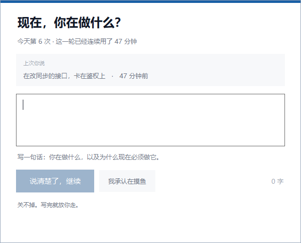
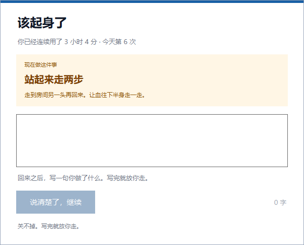
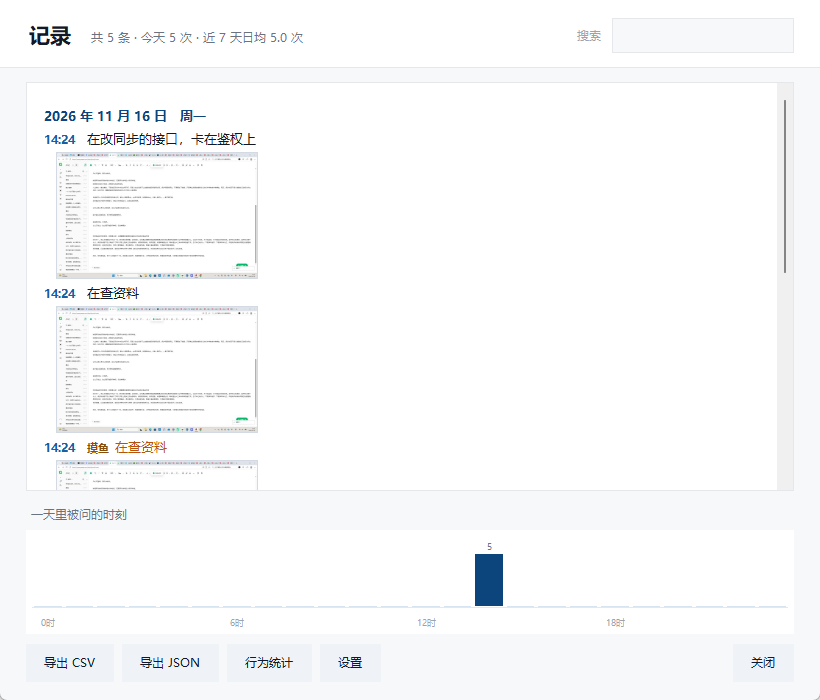
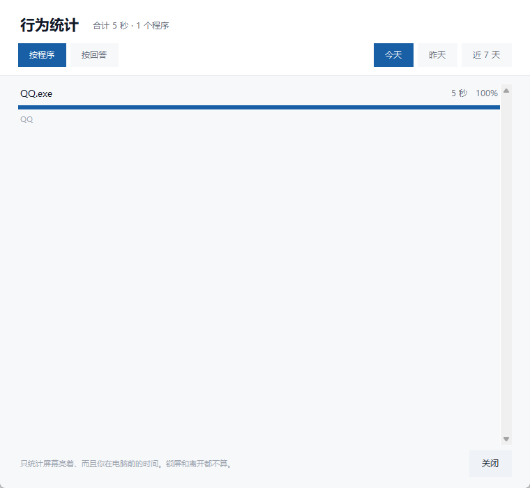
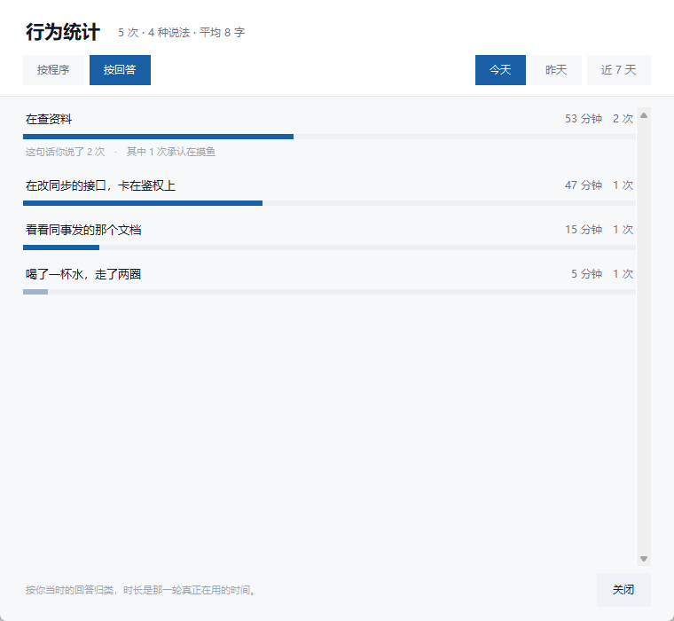
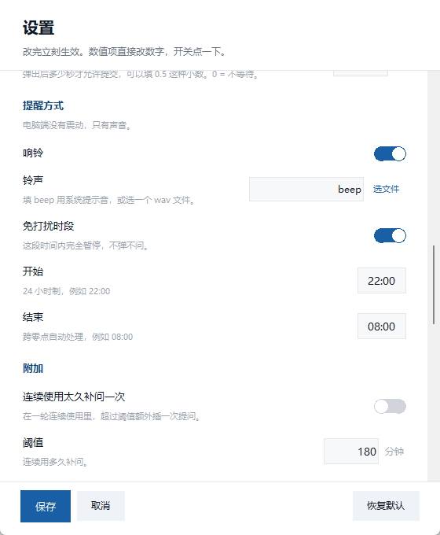

# 质问我 · Grill Me

> 一个会随机把你拦下来、逼你说清楚「为什么现在必须做这件事」的小工具。电脑和安卓两端。

**English name: Grill Me.** `grill someone` 是「长时间、不客气地盘问」；`Grill me.` 本身就是一句
完整的祈使句，正好对应中文名「质问我 · 监督我」。界面支持中文 / English / 日本語 / Русский。

`grill` 是动词：长时间、不客气地盘问一个人。比 "ask me" 更接近这个东西的性格。

它不是时间记录器，也不是番茄钟。它防的不是"开始不了"，而是"停不下来"。

你大概有过这种时刻：打开一个网页"就看两分钟"，抬头已经过了一小时；或者在三个 App
之间来回切，什么都没做完，但也没停下来。这类时间浪费的问题不在于你不知道自己在干嘛，
而在于**没有人问过你**。

所以它只做一件事：在你干活的过程中，随机挑一个你想不到的时刻，盖住整个屏幕，
问你一句「现在，你在做什么，为什么现在必须做它」。你必须打字说出来，才放你走。

它不拦你、不锁屏、不说教。你写"我在刷视频"，它也只记下来。

## 界面

| 查岗弹窗 | 坐太久了，该起身 |
|---|---|
|  |  |

| 记录（截图直接显示在下面） | 按程序统计 |
|---|---|
|  |  |

| 按回答统计 | 设置 |
|---|---|
|  |  |

## 三条规则

1. **只在真正"在用"的时候计时和弹窗。** 屏幕亮着就算在用——发呆、看视频、读长文档都不算离开。
   锁屏或长时间无输入（且不在全屏播放）才停表，回来不补算。
2. **每 40–90 分钟随机弹一次。** 区间可改，但**不显示倒计时**，因为可预期的查岗是可以提前准备的。
3. **必须打字才能关掉。** 没有关闭按钮，Esc 和 Alt+F4 都无效，至少写 2 个字（可改）。

## 功能

**查岗**

- 随机间隔 40–90 分钟，支持免打扰时段
- 强制输入：禁止粘贴，冷静期可精确到 0.1 秒（弹出后等一会儿才允许提交）
- 弹窗里显示上一句回答，以及它过去了多久
- 锁屏模式：屏幕黑了但人还在（发呆、躺床上），仍计时并响铃，解锁后补弹

**记录**

- 长期保存，按天分组、可搜索、可导出 CSV / JSON
- **重复答案标色**：同一句话第 2 次出现变黄，第 3 次起变红
- **弹窗前自动截图**，压缩后存在本地，缩略图直接显示在对应记录下面，点开看大图

**统计**

- **按程序**：每秒采样前台窗口，按秒累计。能看出 `chrome.exe` 用了 2 小时，其中 40 分钟在 B 站
- **按回答**：按你当时的回答归类，能看出「'在查资料' 这句话你说了 12 次，占了 2 小时 40 分」
- 今天 / 昨天 / 近 7 天三档切换

**提醒身体**

- 连续使用超过阈值（默认 180 分钟，可关）时，插一次起身提醒
- 内置 14 条建议随机轮换：喝水、远眺、闭眼、转脖子、甩手腕、深呼吸、后仰、把手机推远……
- 提醒本身也要求写一句「你做了什么」，所以统计里能看到"喝水 3 次"

**可选同步**

- 任何支持 WebDAV 的服务（坚果云、Nextcloud、群晖、自建都行），设置里填地址和账号密码
- 只合并记录，不同步设置和计时状态

## 快速开始

Windows 10 / 11，Python 3.9 或更高（只用标准库，**不需要安装任何第三方包**）。

```bat
git clone https://github.com/<your-name>/grill.git
cd grill
python grill.py
```

也可以直接双击 `启动电脑端.bat`（会用 `pythonw` 静默启动，不留控制台窗口）。

第一次运行不会立刻弹窗，默认 25 分钟后才可能第一次问你。想马上看效果：
右键右下角的悬浮条 → **立刻问我一次**。

调试用参数：

```bat
python grill.py --demo        :: 启动后立刻弹一次
python grill.py --selftest    :: 只做环境自检，不开窗口
```

## 安卓端

同一套逻辑的安卓实现，纯 Java、不用 AndroidX、不引第三方库，APK 只有 80 KB 左右。

- **安装**：`dist/grillme-1.0.0.apk`（或自己构建，见下）。
- **三件事必须授权，第四件可选**，首页会逐项提示、点一下就跳到系统设置：
  1. 悬浮窗（`SYSTEM_ALERT_WINDOW`）——质问窗用悬浮窗实现，这样才能绕过 Android 10+ 的后台启动限制；
  2. 使用情况访问（`PACKAGE_USAGE_STATS`）——只用来读"当前前台是哪个 App"，做行为统计；
  3. 通知——常驻通知显示"下一次质问还有多久"；
  4. 截屏授权（`MediaProjection`，可选）——**弹窗前截图**要用。安卓不允许后台偷偷截屏，
     必须由你在系统弹窗里点一次「开始」，之后它才能自己抓帧；重启手机后要重新点一次。
     不开这个开关也照常工作，只是记录里没有截图。
     - 小米 / HyperOS 这类 ROM 的弹窗里有一项「应用范围」，一定要选**整个屏幕**，
       选成「单个应用」就只会抓到那一个 App 的画面。安卓 14 以上程序会主动声明要整屏，
       多数机器已经默认选好。
     - 授权后状态栏会一直显示「屏幕共享」，这是系统的强制提示，关不掉，不是程序在偷偷录。
     - 关于耗电：抓帧管道只在**快到质问时间的那 20 秒**才接上，其余时间主动断开合成，
       所以不会因为一直挂着投屏就持续吃电。屏幕静止时开销为 0；只有在带动画的 App 里
       刚好赶上那 20 秒，才会多合成一份 800px 的副本。
- **建议**：把电池优化白名单也打开，否则部分国产 ROM 会杀掉常驻服务。
- **构建**：`cd android && gradle assembleDebug`，产物在 `android/app/build/outputs/apk/debug/`。

安卓端和电脑端的差异（都是有意的）：

| | 电脑端 | 安卓端 |
|---|---|---|
| 无输入判定 | 读系统最后输入时间，无输入可停表 | 安卓没有全局"最后输入时间"，一律「屏幕亮着就在用」 |
| 弹窗时的截图 | 有，弹窗前截一张 | 有，但要走系统投屏授权（点一次「开始」），重启后需重新授权 |
| 按窗口统计 | 能读窗口标题 | 只有按应用统计 + 按回答统计（安卓拿不到别的 App 的窗口标题） |
| 记录存储 | JSONL 文件 | SQLite（导出仍是同一格式的 JSONL，可互通） |

## 数据在哪

全部在 `%APPDATA%\Grill\`，纯文本，随时可以备份或删掉：

| 文件 | 内容 |
|---|---|
| `log.jsonl` | 所有回答，一行一条，只追加不修改 |
| `usage\YYYY-MM-DD.json` | 每天的时间分布聚合 |
| `shots\YYYY-MM-DD\*.jpg` | 弹窗前的截图，默认保留 30 天 |
| `config.json` | 设置（改过设置才生成） |
| `state.json` | 当前计时状态，重启后接着算 |

> 早期版本叫 AskMe，数据在 `%APPDATA%\AskMe\`。首次启动会自动搬过来，搬不动就继续用旧目录，不会丢记录。

## 隐私

- **纯本地，零网络请求。** 不开同步就完全不出网。
- 截图只存在你自己的硬盘上，不会上传到任何地方。
- 窗口标题可能包含文档名或网址，介意的话在设置里关掉「同时记录窗口标题」，
  就只记程序名（比如 `chrome.exe`）。
- 同步功能是你自己填的 WebDAV 服务器，数据只在你和你的网盘之间流动。

## 设置里值得调的几项

| 项 | 默认 | 说明 |
|---|---|---|
| 最短 / 最长间隔 | 40 / 90 分钟 | 觉得烦就拉长，别关判定 |
| 长时间无输入就停表 | 开 | 关掉后只要不锁屏就一直计时，适合挂着看长视频 |
| 锁屏后仍然计时和提醒 | 关 | 打开后连"没碰设备但在发呆"也管，靠响铃叫你回来 |
| 禁止粘贴 | 开 | 否则"允许重复"就变成"允许复制上次答案" |
| 冷静期 | 3.0 秒 | 可以填 0.5 这种小数，防止肌肉记忆糊过去 |
| 免打扰时段 | 22:00–08:00 | 时段内完全停表，不会半夜响 |
| 弹窗前自动截图 | 开 | 800px / 质量 60，一张约 24KB |

## 同步（可选）

在设置里填任何支持 WebDAV 的服务：

- 服务器地址，例如 `https://dav.example.com/dav/Grill/`
- 账号 + **应用密码**（不是登录密码）
- 设备名（两台设备必须不一样，比如 `pc` / `android`）

填完点「测试连接」可以立刻验证，401 会说账号密码不对，404 会说目录不存在但账号能通过。

合并规则是**按记录 id 求并集**：记录只追加、不修改、不删除，所以两台设备永远不会冲突，
不需要 CRDT 也不需要冲突提示。各设备只写自己的分片文件（`pc/年-月/日.jsonl`），
连文件锁都不需要。

## 设计取舍

几个明确**不做**的东西，以及原因：

- **不显示"距下次提问还有多久"**。会让人盯着倒计时等，甚至提前把答案想好演一遍。
- **不做 App 白名单**（"用 Excel 时不弹"）。"在用 Excel"不等于"在工作"，那是给自己开后门。
- **不做 AI 分析回答**。要联网、要花钱，还违背"离线可用"这个前提。
- **不做实时推送、秒级同步**。记录不是协同文档，一天同步三次足够。
- **不用 Electron**。一个随时在后台盯着你的东西，不该自带 100MB 的浏览器。

## 已知限制

- 只支持 Windows（用的是 Win32 API 判定锁屏、全屏、前台窗口）。
- 锁屏模式靠响铃提醒，开会前记得先暂停。
- 全屏判定只认主屏，副屏全屏播放可能被判定为"离开"。
- 安卓端比电脑端少几样：没有"无输入"判定（安卓不给全局最后输入时间）、
  拿不到别的 App 的窗口标题（只能按应用统计），截图要走一次系统投屏授权。

## License

MIT
